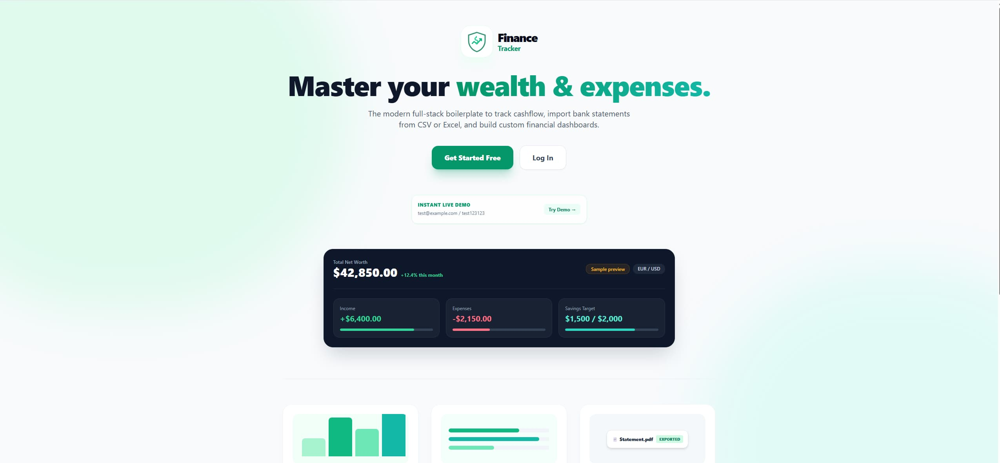
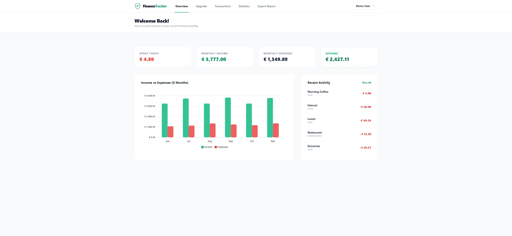
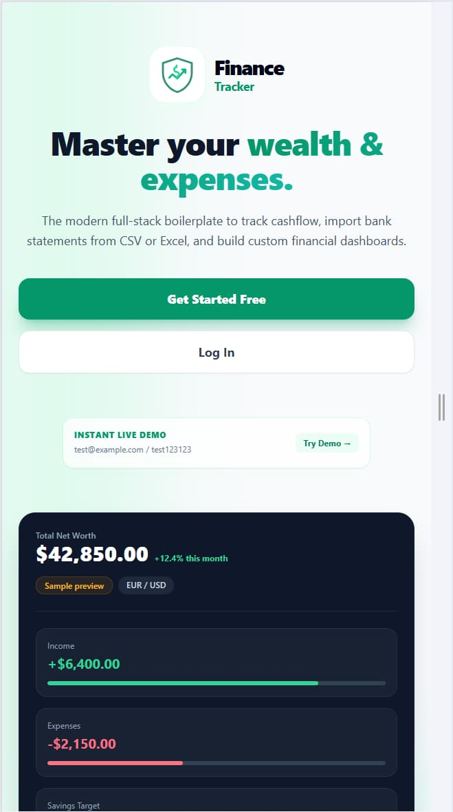
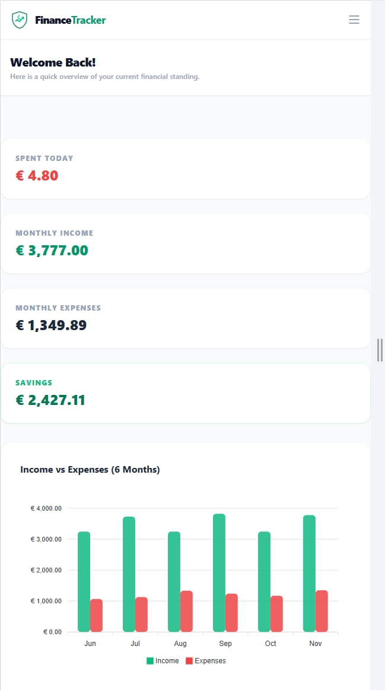
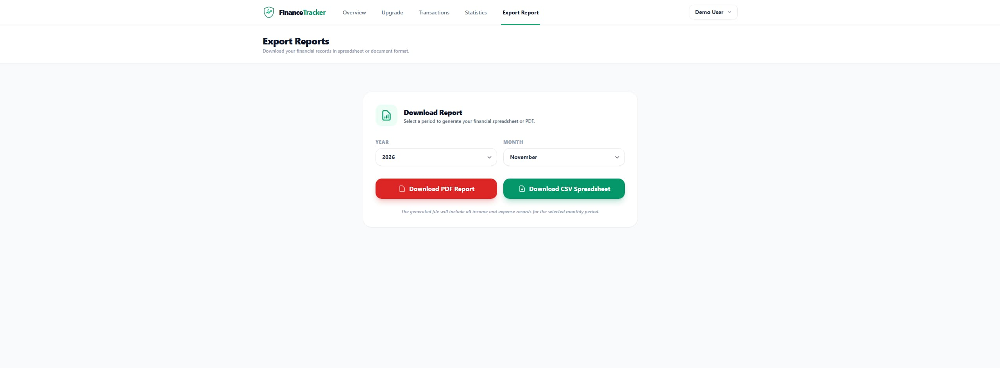
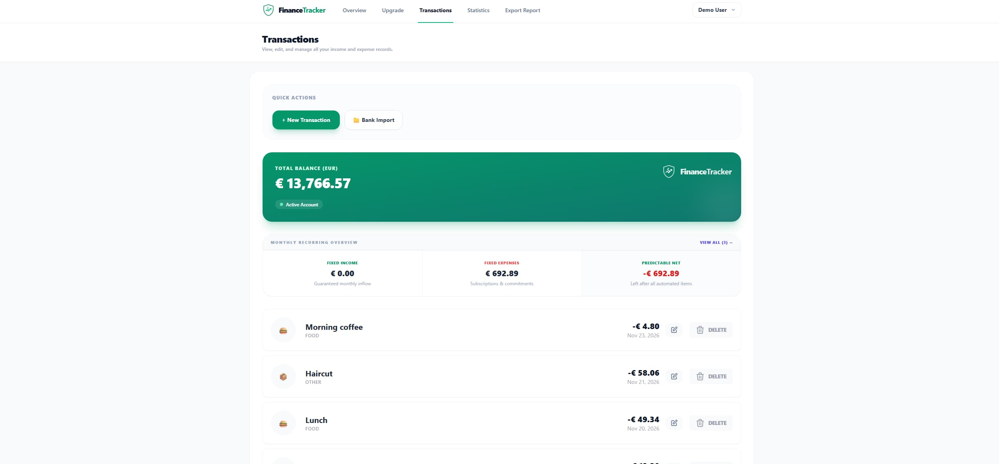

# FinanceTracker

A personal finance web app: track income and expenses, set category budgets, import bank statements, switch currencies and upgrade to a Pro plan through Stripe.

Built with **Laravel 12**, **Vue 3 (TypeScript)** and **Inertia.js**.

**Live demo:** https://finance-tracker-cedomir.up.railway.app/
Click **Try Demo** on the landing page to sign in with a shared demo account (`test@example.com` / `test123123`).
The demo account has Pro features unlocked. Changing the password or e-mail, deleting the account and Stripe actions are disabled, and its data is reset every night.

## Screenshots

### PC
| Welcome Page | Dashboard |
| --- | --- |
|  |  |
|Mobile|
| --- | --- |
|  |   |


| Export| Transactions |
| --- | --- |
|  |  |


mobile 

---

## Features

**Everyday tracking**
- Dashboard with today's spending, monthly income / expenses / savings, a 6-month income vs. expenses chart and the latest transactions.
- Add, edit and delete transactions, grouped into categories, with pagination.
- Recurring transactions (rent, subscriptions): a monthly template with a billing day. A scheduled job creates the real transaction on that day. Templates are shown in a separate "Monthly recurring overview" and are not counted as transactions.

**Statistics and budgets**
- Month / year selector, donut chart by category (expenses or income) and drill-down to the transactions behind each category.
- Monthly budget per expense category with an "over by" warning (Pro).

**Bank statement import (Pro)**
- Upload a CSV or Excel file (up to 5 MB), map the date / description / amount columns and choose the statement currency.
- Understands common number formats (`1.234,56`, `1,234.56`, `(45,50)`), rejects wrongly mapped columns instead of importing garbage, and imports everything or nothing.
- Runs in a background queue job. Imported rows keep their original date.

**Multi-currency**
- Change the account currency in the profile. All transactions are re-converted with historical exchange rates from the [Frankfurter API](https://frankfurter.dev). If the rate service is unavailable the change is refused and nothing is modified.

**Export**
- CSV export for everyone, PDF report for Pro. CSV cells are protected against spreadsheet formula injection.

**Billing (Stripe + Laravel Cashier)**
- Free plan (15 transactions / month) and Pro plan with Stripe Checkout and the Customer Portal.
- Subscription state is kept in sync through Stripe webhooks, cancellations keep Pro until the paid period ends, and deleting an account cancels the Stripe subscription.

**Accounts and operations**
- E-mail verification and transactional e-mails (Resend), login rate limiting, error tracking with Sentry.
- A demo mode with a one-click demo login and a nightly reset.

---

## Tech stack

| Area | Technology |
| --- | --- |
| Backend | Laravel 12, PHP 8.2+ |
| Frontend | Vue 3 (Composition API) + TypeScript, Inertia.js 2, Tailwind CSS, ApexCharts |
| Database | MySQL or PostgreSQL |
| Payments | Stripe, Laravel Cashier |
| Queue / scheduler | Laravel database queue, one nightly artisan command |
| Files | Laravel Excel (import), DomPDF (reports) |
| Other | Resend (e-mail), Sentry, Frankfurter API (exchange rates), Ziggy |
| Hosting | Railway (web, queue worker and cron services) |

---

## Design decisions worth a look

- **Modern monolith.** Inertia keeps routing, validation and authentication in Laravel while the UI stays a Vue SPA. No separate API to maintain.
- **Planned vs. actual money.** A recurring template is a plan, the transaction created by the scheduler is the real one. Balance, statistics and exports only count real transactions.
- **One "effective date".** Reports use the transaction date from an imported statement when there is one and the creation date otherwise, so importing three months of history lands in the right months.
- **Background jobs that fail safely.** Bank imports and currency conversions calculate everything first and write in one database transaction. A failure leaves the data untouched and shows the user a clear message.
- **Stripe is the source of truth.** The app trusts webhooks, not the redirect after checkout.
- **Demo without a mail domain.** In demo mode new accounts are verified automatically, and a nightly job restores the demo data.

---

## Known limitations

- Bank import supports CSV and Excel only (no PDF), one statement currency per file.
- `03/04/2026` is read as month/day, `03.04.2026` as day.month.
- Exchange rates come from European Central Bank reference rates, so only the currencies Frankfurter supports are available.
- The e-mail provider runs in test mode on the demo, so real e-mails are only delivered to a verified address.
- Automated tests currently cover authentication and profile only.

---

## Run it locally

```bash
git clone https://github.com/CedomirMitic/finance-tracker.git
cd finance-tracker

composer install
npm install

cp .env.example .env
php artisan key:generate
# set the DB_* values in .env

php artisan migrate
```

In three terminals:

```bash
php artisan serve        # app
npm run dev              # Vite
php artisan queue:work   # background jobs (import, currency conversion)
```

Optional: set `DEMO_MODE=true` and run `php artisan db:seed --class=DemoSeeder` to get a demo account with six months of sample data.
Stripe, Resend and Sentry keys are only needed for billing, e-mail and error tracking.

---

Built by Cedomir Mitic.
